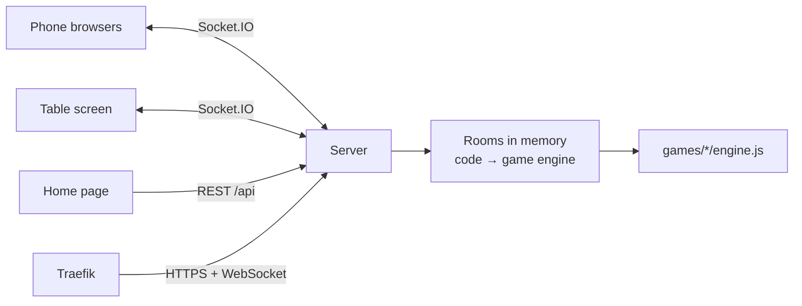

# Game Night

Self-hosted card games for family and friends. Pick a game, start a lobby and
share its 4-letter code or link; everyone plays from their phone's browser.
A TV or laptop can optionally show the whole table.

Games:

- **[Flip 7](games/flip7/README.md)**: push-your-luck number flipping,
  first to 200 (2–12 players).
- **[Cover Your Assets](games/cover-your-assets/README.md)**: collect and steal
  sets of assets, first to $1,000,000 or a one-round quick game (2–6
  players). Classic rules; card values are in
  `games/cover-your-assets/engine.js`.
- **[Five Crowns](games/five-crowns/README.md)**: rummy with five suits
  and a wild card that changes every round; lowest score after 11 rounds
  wins (2–7 players).
- **[Hand and Foot](games/hand-and-foot/README.md)**: canasta-style rummy,
  every player for themselves: play your hand, then your foot, and go out
  with 2 clean books and 1 dirty; highest score after 4 rounds wins (2–6
  players).
- **[Oh Hell](games/oh-hell/README.md)**: trick-taking where you bid the
  exact number of tricks you'll win; hands shrink and grow each round
  (3–7 players).
- **[Fits the Bill](games/fits-the-bill/README.md)**: a judge reveals a
  describing word, everyone plays the thing from their hand that fits it
  best, and the judge picks a winner without knowing whose it is (3–10
  players).

Each game's folder has its own README with its rules and how its engine works.

## How to play

1. Open the site and press **Start a lobby** on a game. You land on that
   room's phone page; join with your name.
2. Share it: **Invite people** (share sheet or copy link), read out the room
   code (others enter it on the home page), or open the **table screen**
   (`/r/<code>/board`) on a TV, which shows a QR code.
3. Anyone in the lobby presses **Start game**.

If a phone locks or reloads, it rejoins its seat automatically. If someone
drops out, the table screen offers to act for them, and players can be
removed between rounds. Rooms close after 12 hours without use.

Testing alone: add `?seat=2`, `?seat=3`… to a room URL to get separate
players in one browser.

## Running it

**Locally** (Node 20+):

```sh
npm install
npm start        # npm run dev to restart on changes; npm test for tests
```

Open `http://localhost:3000`. Phones on the same Wi-Fi use the LAN address
the server prints (the board's QR code uses it automatically).

**On a server behind Traefik** (Docker):

```sh
cp .env.example .env    # set GAMES_HOST, and the entrypoint/cert resolver names
docker compose up -d --build    # joins Traefik's existing `frontend` network
```

Settings (environment): `PORT` (3000), `PUBLIC_URL` (base for join links and
QR codes; compose sets it from `GAMES_HOST`), `MAX_ROOMS` (50),
`ROOM_IDLE_HOURS` (12).

## Tech stack

| Layer | Technology |
|-------|------------|
| Server | Node.js 22 (20+ supported), Express 5 |
| Real-time | Socket.IO 4 |
| Clients | Plain HTML/CSS/JS modules, no build step |
| Tests | `node:test`, socket.io-client |
| Deployment | Distroless container, Docker Compose, Traefik |

## Architecture



- **`server/app.js`**: HTTP routes (home, `/r/<code>` pages, `/api/*`) and
  the Socket.IO hub. Sockets name their room in the handshake; after every
  action each socket gets `game.view(itsPlayerId)`, so engines decide what
  each seat may see (hidden hands).
- **`server/rooms.js`**: room codes, seat tokens, connection counts, idle
  sweeping. **`server/games.js`**: the game registry and engine contract.
- **`games/<id>/`**: one folder per game: `index.js` (descriptor and socket
  actions), `engine.js` (pure rules state machine), `public/` (phone page
  `play.html`, table screen `board.html`), `test/`.
- **`public/`**: home page and `lib/room.js`, the client helper every game
  page uses (socket, seat token, toasts, share link).

All state is in memory; restarting the server ends every game.

## Key flows

- **Start a lobby**: `POST /api/rooms {gameId}` returns a code; the browser
  goes to `/r/<code>`, which serves that game's `play.html`.
- **Join / rejoin**: the page connects with `auth.room`, then sends its
  stored token (`hello`). A known token re-attaches the seat; otherwise the
  page shows the join form and `join` returns a new token, kept per room in
  localStorage.
- **A move**: the page emits a game event (`hit`, `pair`, `challenge`…); the
  server looks it up in the game's `actions`, the engine validates and
  applies it, and every socket in the room gets its own view. Rule errors go
  back to the sender only, as `problem`.

## Adding a game

Create `games/<id>/` with `index.js`, `engine.js` and `public/play.html` +
`board.html` (copy Flip 7's shape), then register it in `server/games.js`.
The contract an engine must meet is documented there.

## Where things live

```
server/            index.js (entry), app.js, rooms.js, games.js, game-error.js
games/flip7/       Flip 7 engine, pages, tests
games/cover-your-assets/   Cover Your Assets engine, pages, tests
games/five-crowns/ Five Crowns engine, meld solver, pages, tests
games/hand-and-foot/       Hand and Foot engine, pages, tests
games/oh-hell/     Oh Hell engine, pages, tests
games/fits-the-bill/       Fits the Bill engine, original card text, pages, tests
public/            home page, lib/room.js
test/              server integration tests
specs/             per-feature specs
docs/decisions/    decision and gotcha records
Dockerfile, docker-compose.yml, .env.example   deployment
```

## Environment

- **Local**: any machine with Node 20+; allow incoming connections on the
  port if the OS firewall asks. No secrets, no external services.
- **Production**: one container behind Traefik on a host name such as
  `games.example.com` (serve at the root of a host; there is no sub-path
  setting). TLS ends at Traefik; WebSockets need no extra config. The
  container has no published ports, no volumes, a read-only filesystem and
  no capabilities, and its only network is Traefik's `frontend` (see
  `docs/decisions/2026-11-21-traefik-frontend-network.md`).
  There is no login: anyone with the URL can start or join a game. To limit
  it to family, add a Traefik middleware (basic auth or your forward-auth
  SSO) to the router's labels.
