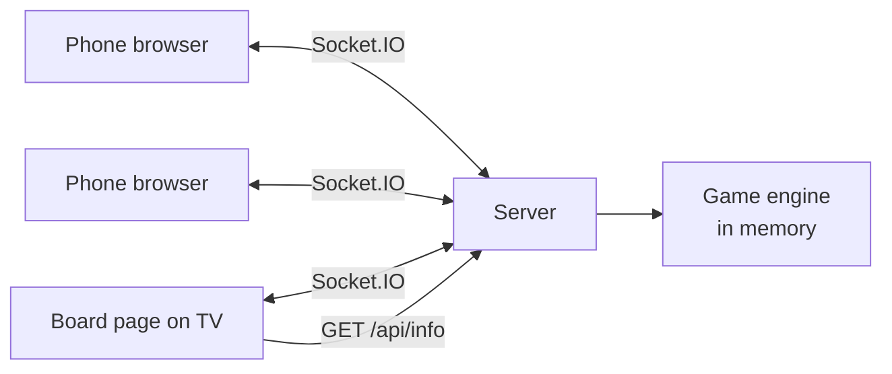

# Flip 7

A digital version of the Flip 7 card game for playing in the same room.
One computer runs the server and shows the table on a TV; everyone plays from
their phone's browser.

## How to play

```sh
npm install
npm start
```

The server prints two addresses:

- **Table screen** — `http://localhost:3000/board`. Open it on the computer
  connected to the TV (full-screen it with F11 / ⌃⌘F).
- **Players join** — `http://<your-LAN-IP>:3000/`. The board shows this as a
  QR code; phones must be on the same Wi-Fi.

Everyone joins in the lobby, then anyone presses **Start game**. On your turn
your phone shows **HIT** / **STAY**; when you draw a Freeze, Flip Three or a
spare Second Chance, it asks you who to give it to. Between rounds anyone can
press **Next round**. First to 200 wins.

If a phone locks or reloads, it rejoins its seat automatically. If someone
drops out entirely, the board offers a button to act for them (stay, or pick
a random target), and players can be removed between rounds.

Settings: `PORT` (default 3000) and `PUBLIC_URL` (override the join URL, e.g.
if the wrong network interface is detected).

Testing alone: add `?seat=2`, `?seat=3`… to the phone URL to get separate
players in one browser.

## Rules implemented

94 cards: one 0, then each number 1–12 as many times as its value; +2, +4, +6,
+8, +10 and ×2 once each; three each of Freeze, Flip Three and Second Chance.

- A duplicate number busts you (0 points) unless you hold a Second Chance,
  which cancels it. You can hold only one; extras go to another active player.
- **Freeze**: the drawer picks an active player, who banks their points and
  is out of the round.
- **Flip Three**: the drawer picks an active player, who flips three cards.
  Freeze / Flip Three drawn during it are resolved afterwards (discarded on a bust).
- Seven different numbers is a **Flip 7**: +15 and the round ends at once.
- Score = numbers (doubled by ×2) + modifiers + bonus. The dealer rotates; the
  deck carries over between rounds and the discards are reshuffled when it runs out.

## Tech stack

| Layer | Technology |
|-------|------------|
| Server | Node.js 20+, Express 5 |
| Real-time | Socket.IO 4 |
| Clients | Plain HTML/CSS/JS modules, no build step |
| Tests | `node:test` |

## Architecture



- **`server.js`** — serves the pages, maps session tokens to players, turns
  socket events into engine calls, and broadcasts the state after each one.
- **`src/game.js`** — the rules engine: a pure state machine with no I/O.
- **Phone page** (`/`) — join form, your hand, hit/stay, target picker.
- **Board page** (`/board`) — lobby with QR code; during play, every
  player's cards, scores and an event log.

All state is in memory; restarting the server ends the game.

## Key flows

- **Join / rejoin**: on connect the client sends its stored token (`hello`).
  A known token re-attaches the socket to its seat; otherwise the phone shows
  the join form, and `join` creates a player and returns a new token.
- **A move**: the phone emits `hit`/`stay`/`choose`; the server calls the
  engine, which validates it (turn, pending choice) and runs the resulting
  draws; the server then broadcasts `state` to every client. Rule errors go
  back to the sender only, as `problem`.
- **Pausing for choices**: the engine queues work as a task stack; when a
  draw needs a decision (Freeze target, etc.) it sets `pending` and stops
  until the named player answers, then resumes the deal or Flip Three.

## Where things live

```
server.js          HTTP + Socket.IO server
src/game.js        rules engine
test/              engine tests (npm test)
public/            phone page (index.html, player.*), board (board.*), shared ui.js/style.css
docs/decisions/    decision and gotcha records
```

## Environment

- Runs on any machine with Node 20+. Phones must reach the server over the
  LAN, so allow incoming connections on the port if the OS firewall asks.
- No secrets, no external services. The QR code is generated locally.
